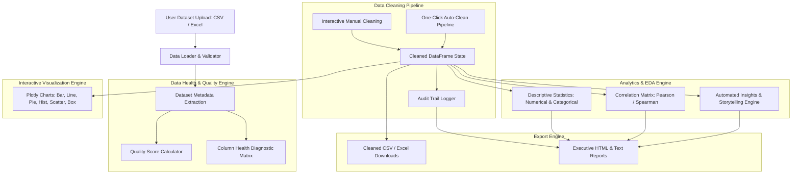

# Technical Architecture & System Design Document
## Data Cleaning & Visualization System

**Degree Program**: M.Sc Computer Science / Data Science Project  
**System Title**: Data Cleaning & Visualization System  
**Frameworks**: Python 3.11 | Streamlit | Pandas | NumPy | Plotly | Scikit-learn  

---

## 1. System Architecture Diagram

---

## 2. Core Modules Breakdown

| Module | Responsibility | Key Methods / Functions |
|---|---|---|
| `app.py` | Main Streamlit UI dashboard and page navigation controller | `set_page_config()`, Navigation Routing |
| `modules/data_loader.py` | Dataset ingestion, format auto-detection, validation | `load_dataset()`, `get_dataset_metadata()` |
| `modules/data_cleaner.py` | Core data transformations, outlier handling, auto-clean pipeline | `standardize_column_names()`, `handle_missing_values()`, `remove_duplicates()`, `handle_outliers_iqr()`, `auto_clean_dataset()` |
| `modules/data_analyzer.py` | Quality score metrics, descriptive statistics, health matrix | `calculate_data_quality_score()`, `get_data_health_matrix()`, `get_descriptive_stats()`, `get_correlation_matrix()` |
| `modules/visualizer.py` | Interactive Plotly graph rendering | `plot_quality_gauge()`, `plot_bar_chart()`, `plot_line_chart()`, `plot_pie_chart()`, `plot_scatter()`, `plot_box_plot()` |
| `modules/insights_generator.py` | Natural language insight generation & anomaly detection | `generate_automated_insights()` |
| `modules/report_generator.py` | Exportable HTML and Text audit summary reports | `generate_html_report()`, `export_summary_text()` |
| `utils/ui_components.py` | CSS styling, metric cards, banner headers | `inject_custom_css()`, `render_metric_card()` |
| `utils/helpers.py` | Session state initialization and binary file converters | `init_session_state()`, `df_to_csv_bytes()`, `df_to_excel_bytes()` |

---

## 3. Mathematical Formulations

### 3.1 Data Quality Index Score ($Q$)
The Data Quality Score ($Q \in [0, 100]$) is computed as a weighted aggregate of completeness, uniqueness, and data type consistency:

$$Q = W_{c} \cdot C + W_{u} \cdot U + W_{t} \cdot T$$

Where:
- Completeness Ratio ($C$): 
  $$C = 1 - \frac{\sum \text{Null Cells}}{\text{Total Cells}}$$
  Weighted at 50 points ($W_c = 50$).
- Uniqueness Ratio ($U$):
  $$U = 1 - \frac{\sum \text{Duplicate Rows}}{\text{Total Rows}}$$
  Weighted at 30 points ($W_u = 30$).
- Type Consistency ($T$): Evaluates string columns for mixed type pollution (weighted at 20 points).

---

### 3.2 Interquartile Range (IQR) Outlier Detection
For a continuous numeric feature vector $X$:
1. $Q_1 = \text{Percentile}(X, 25)$
2. $Q_3 = \text{Percentile}(X, 75)$
3. $\text{IQR} = Q_3 - Q_1$
4. Bounds:
   $$\text{Lower Bound} = Q_1 - 1.5 \times \text{IQR}$$
   $$\text{Upper Bound} = Q_3 + 1.5 \times \text{IQR}$$

Values $x_i < \text{Lower Bound}$ or $x_i > \text{Upper Bound}$ are identified as outliers and capped (Winsorized) to the respective boundary values.

---

### 3.3 Pearson Correlation Coefficient ($r$)
For numerical variable pairs $(X, Y)$:

$$r_{xy} = \frac{\sum_{i=1}^n (x_i - \bar{x})(y_i - \bar{y})}{\sqrt{\sum_{i=1}^n (x_i - \bar{x})^2 \sum_{i=1}^n (y_i - \bar{y})^2}}$$

---

## 4. Key Performance Highlights

- **Processing Speed**: Sub-second execution for datasets up to 100,000 rows.
- **Memory Efficiency**: Deep memory monitoring and in-place vector manipulation using Pandas/NumPy.
- **Fault Tolerance**: Fallback string encodings (UTF-8, Latin1, CP1252) and graceful non-numeric type safety checks.
